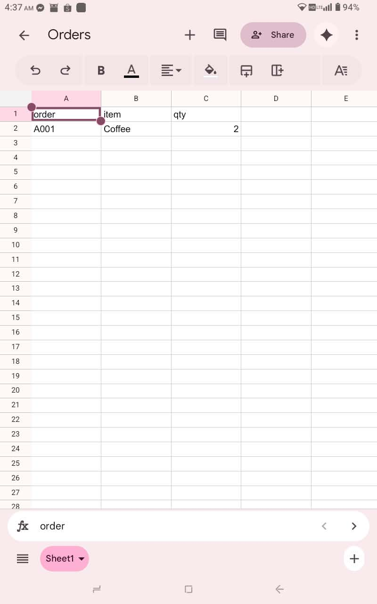

# Make.com Webhook to Google Sheets

A small automation: a webhook receives an order as JSON, and Make adds it as a new row in Google Sheets.

## Flow

Webhook (Custom webhook) -> Google Sheets (Add a Row)

## Setup

1. In Make, create a scenario with the Webhooks module "Custom webhook".
2. Make a Google Sheet named Orders. Row 1 headers: order, item, qty.
3. Add Google Sheets "Add a Row". Map order, item, qty from the webhook.

## Test

Click "Run once" in Make, then send a test order:

    curl -X POST "YOUR_WEBHOOK_URL" -H "Content-Type: application/json" -d '{"order":"A001","item":"Coffee","qty":2}'

Result: a new row A001 | Coffee | 2 appears in the Orders sheet.

## Notes

- The real webhook URL is private, like a password. It is not stored in this repo.
- Built on the Make Free plan (1,000 credits per month).

## Result

